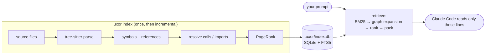

# uxor

**A lightweight code map for Claude Code. It points your AI agent to the
right lines instead of letting it grep and read whole files.**


uxor indexes your repository into a small local code graph (symbols, calls,
imports, tests) and gives Claude Code the **file and line ranges that
matter** for each prompt. It never returns the code itself. The agent then
reads 20 lines instead of 2,000, and spends far fewer tokens finding them.

```text
You:   how do we get a user by id?

uxor → Likely relevant locations (uxor; read these line ranges before searching broadly):
       store/user.go:24-24  method GetUserByID(id int) (*User, error)
       store/user.go:27-27  type userID = int
       store/user.go:34-36  func NewMemRepo() *memRepo
       store/user.go:38-44  func (r *memRepo) GetUserByID(id int) (*User, error)
       store/user_test.go:5-10  test func TestGetUserByID(t *testing.T)
       api/handler.go:19-25  func (h *Handler) Show(id int) string
       api/handler.go:32-35  func Render(repo store.Repository, id int) string
```
<sub>Real output on the Go test fixture (`testdata/fixtures/go`): about 100
tokens, injected before Claude starts thinking.</sub>

*About the name:* **uxor** is Latin for "wife", dedicated to mine.

---

## Contents
- [Why uxor](#why-uxor)
- [How it works](#how-it-works)
- [Quick start](#quick-start)
- [Using it with Claude Code](#using-it-with-claude-code)
- [Commands](#commands)
- [Configuration](#configuration)
- [Measured results](#measured-results)
- [Measure it on your own repo](#measure-it-on-your-own-repo)
- [Privacy](#privacy)
- [Supported languages](#supported-languages)
- [Limitations](#limitations)
- [Roadmap](#roadmap)
- [Development](#development)
- [Documentation](#documentation)
- [License](#license)

---

## Why uxor

AI coding agents pay for every token they read. Without help, an agent finds
code by grepping for words it guesses and reading whole files, often several
wrong ones first. That costs money and time, and fills the context window
with irrelevant code.

uxor is built around five principles:

| Principle | What it means in practice |
|---|---|
| **Lightest context** | Answers are pointers (`path:start-end signature`), never code, inside a strict token budget: about 375 tokens per prompt. Only one tool (`find_relevant`, about 200 tokens) is always loaded; the rest load on demand. |
| **Help on every prompt** | A Claude Code hook adds likely locations next to your prompt **before** the model starts, within 250 ms, without the model having to call a tool. If it's late or finds nothing, it prints nothing. |
| **Proof on your own code** | `uxor eval` replays *your* git history and measures how often uxor points at the files each commit changed, honestly: the index is rebuilt at each commit's parent, so the answer can't leak in. |
| **Transparency** | Every result says *why* it's there (`# called-by Render`). Guessed call edges carry confidence weights, and an optional hook log shows exactly what was injected. |
| **Zero footprint** | One binary. No daemon, no network, no telemetry, no API keys. The index stores names, paths and line numbers, **never source code**. |

---

## How it works



1. **Parse.** Every file is parsed with [tree-sitter](https://tree-sitter.github.io/)
   into functions, methods, classes and types (nested ones too, such as
   React handlers inside components), plus every call and import.
2. **Resolve.** Calls and imports are linked into a graph (CALLS, IMPORTS,
   EXTENDS, IMPLEMENTS, TESTS). Each edge has a confidence weight: 1.0 when
   certain, below 1.0 for guesses.
3. **Rank.** **PageRank** finds the code everything depends on.
4. **Retrieve.** For a prompt: full-text search (BM25 over identifier words,
   so "get user by id" finds `getUserById`), then a short walk through the
   graph to related code, then ranking, then packing into the token budget.
5. **Stay fresh.** Indexing is incremental (size and mtime, then a content
   hash). An edit hook re-indexes the file Claude just changed, in about
   30 ms.

The full design, with the theory behind each step (ASTs, BM25, PageRank,
MCP, IR metrics), is in **[docs/ARCHITECTURE.md](docs/ARCHITECTURE.md)**.

---

## Quick start

### Requirements
- **Go 1.26+**
- **A C compiler** (clang or gcc): tree-sitter is C, built through cgo.
  macOS: `xcode-select --install`. Debian/Ubuntu: `apt install build-essential`.
- **git** is recommended but optional. In a git repo, `.gitignore` is
  respected; `uxor eval` needs git history.

### Install
```bash
git clone https://github.com/gayanMadurapperuma/uxor.git
cd uxor
make install                 # builds and installs to ~/bin/uxor (PREFIX=… to change)
```
Make sure `~/bin` is on your `PATH`. Claude Code runs `uxor` by name.

Or with Go directly:
```bash
CGO_ENABLED=1 go install github.com/gayanmadurapperuma/uxor/cmd/uxor@latest
```

> **macOS tip:** when updating, use `make install`. Don't `cp` a new binary
> over the old one: macOS keeps the old code signature and kills the new
> binary on start.

### Set up a project
```bash
cd ~/path/to/your/project
uxor init
```
```text
.mcp.json              create
.claude/settings.json  create
CLAUDE.md              create
✓ parsed 2,982 files                             3.2s
✓ resolved 86,585 edges (full, 50.7% refs)       0.7s
✓ pagerank 49,844 nodes                          0.1s

next: open `claude` here and approve the uxor MCP server (asked once)
```
Then start `claude` in that folder and approve the **uxor** MCP server when
asked. That's it: from now on every prompt gets likely locations attached.

Try it from the terminal too:
```bash
uxor query "where do we validate the session token" --why
```

---

## Using it with Claude Code

`uxor init` merges three things into your project. It's idempotent, and
never overwrites your own settings:

| File | What uxor adds |
|---|---|
| `.mcp.json` | the `uxor` MCP server (`uxor serve`, stdio) |
| `.claude/settings.json` | two hooks: **UserPromptSubmit** (`uxor hook prompt`) and **PostToolUse** after edits (`uxor hook edited`) |
| `CLAUDE.md` | a short note telling the model to use `find_relevant` first (refreshed by re-running `init`) |

**MCP tools**

| Tool | Answers |
|---|---|
| `find_relevant` | "Where should I look for this task?" Ranked files and line ranges in a token budget. *Always loaded.* |
| `get_symbol` | "Where is `UserService.getUserById` defined?" |
| `callers_of` | "Who calls this?", best-resolved first; guesses are marked |
| `callees_of` | "What does this call?" |
| `impact_of` | "What depends on this file?": importers, callers, subclasses, tests |

**Check it's working**
- `/mcp` in Claude Code: uxor is **connected** with 5 tools.
- `/context all`: `mcp__uxor__find_relevant` is listed as **Loaded**.
- To see exactly what the hook injected, add `hook_log: true` to
  `.uxor.yaml`; each prompt is then logged to `.uxor/hook.log`.

---

## Commands

| Command | Purpose |
|---|---|
| `uxor init [--dry-run] [--no-index]` | set up Claude Code for this project, then index |
| `uxor index [--full] [paths…]` | index the project (incremental), or just some files |
| `uxor query "<text>" [--budget N] [--json] [--why]` | what Claude would be told, with reasons |
| `uxor stats [--json]` | files, symbols and edges per language, resolution rates, hubs |
| `uxor eval […]` | measure retrieval on this repo's own history ([below](#measure-it-on-your-own-repo)) |
| `uxor serve` | the MCP server (stdio); started by Claude Code |
| `uxor hook prompt\|edited` | the hooks (JSON on stdin; always exit 0) |
| `uxor disable` / `enable` | pause / resume uxor for this project; the index is kept |
| `uxor forget <glob>…` / `unforget` | keep paths out of the index (a local list, not committed) |
| `uxor clean [-y]` | delete this project's index |

Global flag: `--root <dir>` (default: the nearest `.uxor.yaml` or `.git`
above the current directory).

---

## Configuration

Everything is optional. Put a `.uxor.yaml` in the project root:

```yaml
exclude: ["**/third_party/**", "**/generated/**"]   # added to the defaults
languages: [go, python, typescript, javascript]
max_file_bytes: 1048576          # skip files larger than this
budgets:
  query_tokens: 1000             # find_relevant answer size
  hook_tokens: 500               # prompt-hook block size
  hook_top: 5                    # at most this many files in the hook block
  hook_timeout_ms: 250           # the hook prints nothing if slower
hook_log: false                  # true: log each hook run to .uxor/hook.log
```

These are always skipped: `node_modules`, `vendor`, `dist`, `build`, `.venv`,
`__pycache__`, lockfiles, minified bundles, generated files (`Code generated
… DO NOT EDIT`, `@generated`), files over 1 MB, and anything in
`.gitignore`.

---

## Measured results

Measured with `uxor eval` on three public repositories, using 100 recent
commits each: **each commit's subject line is the query, and the files it
changed are the right answer.** The index is rebuilt at each commit's
*parent*, so the answer can't leak in.

| | django (Python) | prometheus (Go) | vite (TypeScript) |
|---|---|---|---|
| A changed file is in the **hook block** (5 files) | 70% | 77% | 56% |
| A changed file is in the **`find_relevant`** answer | 78% | 80% | 67% |
| Tokens in the hook block, mean | 332 | 409 | 380 |
| Tokens in a `find_relevant` answer, mean | 579 | 774 | 702 |
| Hook latency, p95, in-process | 30 ms | 15 ms | 10 ms |

**Token savings.** In a simulation where the agent reads what uxor points
to, the median reading cost when uxor finds the code was about **5–7k
tokens, against 12–32k for reading the right files in full**, which is
already the best a search-and-read agent can do. Details, method and
caveats are in [docs/BENCHMARKS.md](docs/BENCHMARKS.md).

**Honest caveats**
- Commit subjects are terser than real prompts.
- TypeScript is the weakest of the three languages.
- On small, consistently named repos, plain `grep` is already good, and
  uxor's advantage is smaller.
- An agent-level benchmark (the same task in Claude Code, with vs without
  uxor, in real tokens and cost) is in progress.

---

## Measure it on your own repo

```bash
uxor eval --commits 100 --checkout-parent --savings
```
```text
split    tasks     r@5    r@10    mrr hook hit query hit hook tokens  hook p95 ms
all        100   0.483   0.553  0.609    0.700     0.780         332         29.8
tune        66   0.483   0.582  0.606    0.712     0.833         351         28.1
holdout     34   0.484   0.496  0.613    0.676     0.676         295         31.0
```
<sub>django, 100 commits. `r@5`/`r@10` is the share of changed files in the
top 5/10; MRR is how high the first one ranks (1.0 = always first); the
oldest ⅔ of commits are the tune split and the newest ⅓ the holdout.</sub>

- `--checkout-parent` indexes each commit's parent in a temporary git
  worktree. It's slower, but honest.
- `--savings` estimates token costs against simulated agents.
- `--tuning file.json` (repeatable) compares ranking settings against the
  same indexes.

---

## Privacy

- **100% local.** No network calls, no telemetry, no API keys.
- **No source code is stored.** The index holds identifiers, signatures,
  paths, line numbers and hashes. Code is read from disk only when needed.
- **One index per project,** in `<project>/.uxor/` (mode 0700). Nothing is
  shared between projects, and paths outside the project are rejected.
- **The hook log is off by default.** When on, it keeps prompt excerpts in
  `.uxor/hook.log`, locally.

---

## Supported languages

| Language | Extensions | Import resolution |
|---|---|---|
| Go | `.go` | `go.mod` modules (multi-module repos) |
| Python | `.py`, `.pyi` | source roots, relative imports, re-exports |
| TypeScript | `.ts`, `.tsx`, `.mts`, `.cts` | relative paths, `tsconfig` `paths`/`baseUrl`/`extends`, workspaces |
| JavaScript | `.js`, `.jsx`, `.mjs`, `.cjs` | the same, plus `require()` |

Adding a language takes one tree-sitter query file, one small hooks file
and one registry line ([ARCHITECTURE §18](docs/ARCHITECTURE.md#18-extending-uxor)).

---

## Limitations
- **Heuristic resolution:** about 30–60% of calls resolve. The rest go to
  libraries, by design, or need type inference uxor doesn't do; guesses are
  marked with weights below 1.
- **Infrastructure-as-code** (for example AWS CDK resources declared inside
  constructors) isn't indexed as symbols yet.
- **Edits made outside Claude** (git pull, your editor) are picked up by
  `uxor index`, not automatically.
- **Words, not meaning:** uxor matches words, plus a small synonym list
  (login ↔ sign in). There's no embeddings search yet.
- **Not yet measured on 1M+ line repositories.**

---

## Roadmap
- [ ] Agent-level benchmark: the same tasks in Claude Code, with vs without
- [ ] Keep the index fresh after edits outside Claude, without a daemon
- [ ] Prebuilt binaries (macOS, Linux, Windows) and Homebrew
- [ ] More languages: Java, Rust
- [ ] Framework awareness: routes, AWS CDK resources
- [ ] Optional local embeddings as a second retrieval source

---

## Development

```bash
make build      # bin/uxor
make test       # go vet + all tests
make golden     # regenerate golden files after an intended parser or ranking change; review the diff
make eval REPO=/path/to/repo N=100
```

The test suite covers the parser and resolver (with golden files), the
retrieval pipeline, the MCP tools (in-memory round trips), the hooks, the
setup merging, and the eval itself, using a scripted git history. Every
design decision is recorded, with its reasons and measurements.

Contributions are welcome. Please open an issue first for larger changes.

---

## Documentation

| Document | What's inside |
|---|---|
| [ARCHITECTURE.md](docs/ARCHITECTURE.md) | the whole system, from first principles, with diagrams |
| [DECISIONS.md](docs/DECISIONS.md) | every design decision (D1…), with reasons and numbers |
| [BENCHMARKS.md](docs/BENCHMARKS.md) | measurement method, results, savings model, caveats |
| [TESTING.md](docs/TESTING.md) | how to check every feature by hand |

---

## License

[MIT](LICENSE) © 2026 Gayan Madurapperuma

Built with [tree-sitter](https://tree-sitter.github.io/),
[ncruces/go-sqlite3](https://github.com/ncruces/go-sqlite3) (SQLite + FTS5),
the [Model Context Protocol Go SDK](https://github.com/modelcontextprotocol/go-sdk)
and [cobra](https://github.com/spf13/cobra).
