# uxor: architecture and theory, A to Z

This guide explains **everything** behind uxor, from first principles
to the exact code: why it exists, the computer-science ideas it is built on
(abstract syntax trees, full-text search and BM25, graphs and PageRank, the
Model Context Protocol, information-retrieval metrics), and how each idea is
implemented here. Every section follows the same pattern:

> **Theory** (the general idea) → **In uxor** (how this project applies
> it) → **Code** (where to look) → decision numbers (`D12`) pointing into
> [`DECISIONS.md`](DECISIONS.md) for the full reasoning.

**Viewing the diagrams.** Diagrams are [Mermaid](https://mermaid.js.org).
The flowcharts use *animated edges*: the dashes move in the direction data
flows. That needs Mermaid **11.10 or newer** (GitHub, the
[Mermaid Live Editor](https://mermaid.live), or VS Code with a current
Mermaid preview extension). Older renderers may show an error instead of
those diagrams; paste the block into mermaid.live to see it.

## Contents

| # | Section | # | Section |
|---|---|---|---|
| 1 | [The problem: AI agents pay per token](#1-the-problem-ai-agents-pay-per-token) | 11 | [Retrieval: the core algorithm](#11-retrieval-the-core-algorithm) |
| 2 | [The big picture](#2-the-big-picture) | 12 | [MCP: the Model Context Protocol](#12-mcp-the-model-context-protocol) |
| 3 | [Projects and isolation](#3-projects-and-isolation) | 13 | [Claude Code hooks](#13-claude-code-hooks) |
| 4 | [Choosing files](#4-choosing-files) | 14 | [Setup: `uxor init`](#14-setup-uxor-init) |
| 5 | [Parsing: ASTs and tree-sitter](#5-parsing-asts-and-tree-sitter) | 15 | [The CLI](#15-the-cli) |
| 6 | [Storage: SQLite, WAL, FTS5](#6-storage-sqlite-wal-fts5) | 16 | [Measuring it: the eval](#16-measuring-it-the-eval) |
| 7 | [The indexing pipeline](#7-the-indexing-pipeline) | 17 | [Performance and limits](#17-performance-and-limits) |
| 8 | [Incremental indexing](#8-incremental-indexing) | 18 | [Extending uxor](#18-extending-uxor) |
| 9 | [Resolution: building the graph](#9-resolution-building-the-graph) | 19 | [Glossary](#19-glossary) |
| 10 | [PageRank](#10-pagerank) | 20 | [Further reading](#20-further-reading) |

---

## 1. The problem: AI agents pay per token

### Theory: how an AI coding agent works

A large language model (LLM) such as Claude reads text and writes text. An
**agent** wraps the model in a loop: the model *thinks*, asks to run a
**tool** (grep, read a file, edit a file), sees the tool's output, and
thinks again, until the task is done.

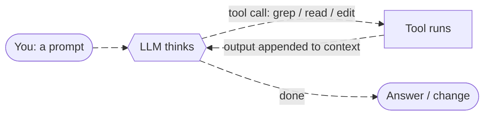

Everything the model has seen in the session (your messages, its replies,
every tool output) sits in its **context window**: a working memory measured
in **tokens**. A token is a chunk of text the model processes as a unit;
for code, about **4 characters per token** is a good rule of thumb, and
uxor uses exactly that estimate (`retrieve.Tokens`, `chars/4` rounded
up).

Tokens matter for four reasons:

1. **Cost**: you pay per token read and written.
2. **Speed**: more tokens, slower responses.
3. **Focus**: irrelevant code competes for the model's attention.
4. **Capacity**: a long task can run out of context.

Without help, an agent finds code by searching for words it guesses (`grep`)
and reading whole files, often several wrong ones before the right one. A
2,000-line file is ~20,000 tokens, even when the relevant function is 20
lines.

### In uxor

uxor builds a **map of the codebase in advance**: every function, class,
method and type, where it lives (file and line range), and how they connect
(who calls whom, who imports what, who tests what). When a prompt arrives, it
consults the map and answers with a few lines like

```
store/user.go:38-44  func (r *memRepo) GetUserByID(id int) (*User, error)
api/handler.go:32-35  func Render(repo store.Repository, id int) string
```

so the agent reads 7 lines instead of two whole files.

**Hard requirements** (from the project brief, `docs/TODO.md` §0):

| Requirement | Why |
|---|---|
| Go, Python, TypeScript/JavaScript first; new languages easy | the common languages; one `.scm` + one hooks file each |
| one static binary, fully local, no services | runs anywhere, nothing leaves the machine |
| **< 100 MB RAM** at query time on 1M+ LOC repos | runs beside your editor |
| **< 200 ms** query latency | interactive |
| prompt hook **< 300 ms**, or print nothing | must never slow down typing |
| **never store source code** in the database | privacy; code is read from disk only when needed |

---

## 2. The big picture

uxor has two halves: **indexing** builds the map, **retrieval** reads it.
Claude Code reaches retrieval two ways: automatically through a **hook** on
every prompt, and on demand through **MCP tools**.

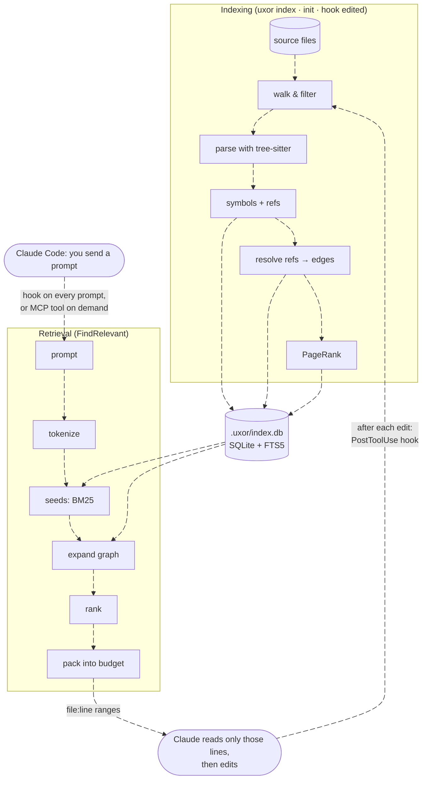

### Package map

Go packages and what depends on what (arrows: "uses").

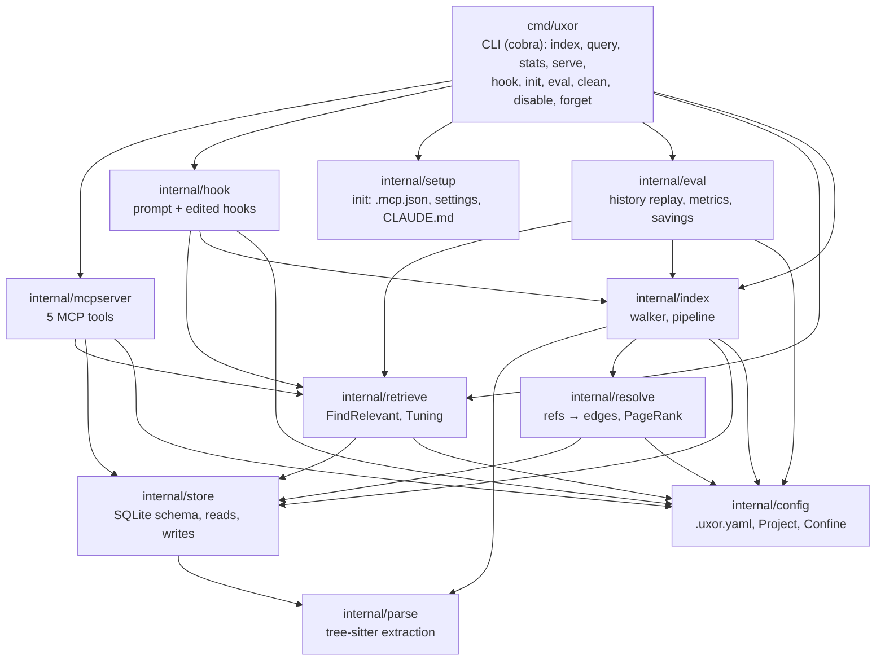

| Package | One-line job |
|---|---|
| `cmd/uxor` | the CLI; every command resolves one project then calls a package |
| `internal/config` | find the project root, load `.uxor.yaml`, path confinement, per-project controls |
| `internal/parse` | source bytes → symbols and unresolved references, via tree-sitter |
| `internal/index` | which files, what changed, parallel parse, batched writes |
| `internal/resolve` | references by name → typed, weighted edges; PageRank |
| `internal/store` | the SQLite schema, migrations, batch writes, graph reads |
| `internal/retrieve` | prompt → ranked, budgeted file:line list |
| `internal/mcpserver` | MCP server exposing retrieval and graph lookups |
| `internal/hook` | the two Claude Code hooks |
| `internal/setup` | what `init` writes and how it merges |
| `internal/eval` | measuring retrieval against git history |

---

## 3. Projects and isolation

### Theory

A tool that indexes code must know **where a project starts and ends**, or
it leaks one repository's information into another's answers. Two common
designs: one global index of everything (simple, but mixes projects), or one
index per project (isolated by construction). uxor chose the second.

### In uxor

- **Root resolution** (`config.FindRoot`): walk up from the start directory
  (`--root`, else the current directory; for hooks, the payload's `cwd`) to
  the nearest directory containing `.uxor.yaml` or `.git`. If none
  exists, the start directory is the root. git is **not required**.
- **One database per project** at `<root>/.uxor/index.db`. The
  directory is created `0700`, the database `0600`; there is no global
  registry and no shared state (D8).
- **Path confinement** (`Project.Confine`): every path from outside (CLI
  arguments, hook payloads, MCP `impact_of`) is cleaned and its symlinks
  resolved; anything that escapes the root is rejected. An edit in another
  repo can never touch this project's index.
- **Nested projects**: a subdirectory with its own `.uxor.yaml`,
  `.uxor/` or `.git` (a submodule, a vendored repo) belongs to *that*
  project and is skipped, unless `include_nested: true` (monorepos).

**Per-project controls** (D9):

| Command | Effect |
|---|---|
| `uxor disable` / `enable` | creates/removes `.uxor/disabled`; hooks and MCP tools check it with one `stat` and go quiet. The index stays and is still updated |
| `uxor forget <glob>` / `unforget` | removes matching files and keeps them out (local list `.uxor/forget.txt`, never committed) |
| `uxor clean [-y]` | deletes `.uxor/` (refuses anything else) |

**Configuration** (`.uxor.yaml`, all optional; defaults in
`config.Default()`):

```yaml
include: ["**/*"]
exclude: ["**/third_party/**"]          # added to the default excludes
languages: [go, python, typescript, javascript]
max_file_bytes: 1048576                 # 1 MiB
include_nested: false
budgets:   { query_tokens: 1000, hook_tokens: 500, hook_top: 5, hook_timeout_ms: 250 }
retrieve:  { seeds: 20, depth: 2, max_per_hop: 50, hub_fanin: 100 }
resolve:   { python_roots: [] }
hook_log: false                         # true: log each hook run to .uxor/hook.log
```

**Code:** `internal/config/config.go`, `internal/config/project.go`.

---

## 4. Choosing files

### Theory

Most of a repository is not *your* code: dependencies (`node_modules`,
`vendor`), build output, lockfiles, generated code, minified bundles.
Indexing them would bloat the index and pollute answers. Version control
already knows much of this through `.gitignore`.

### In uxor

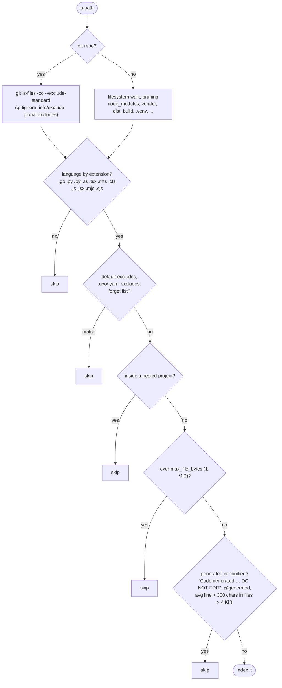

**Default excludes** (always on, `config.DefaultExcludes`): `.git`,
`node_modules`, `vendor`, `dist`, `build`, `.venv`, `venv`, `__pycache__`,
`.uxor`, `.next`, `.tox`, `.mypy_cache`, `coverage`; `*.min.js`,
`*.bundle.js`, `*.pb.go`, `*_pb2.py`, `*_pb2_grpc.py`, `*.generated.*`,
`*.gen.go`; lockfiles (`package-lock.json`, `yarn.lock`, `pnpm-lock.yaml`,
`go.sum`, `poetry.lock`, `Pipfile.lock`, `uv.lock`). TypeScript `.d.ts`
declaration files are skipped by the parser.

Globs are [doublestar](https://github.com/bmatcuk/doublestar) patterns
(`**` crosses directories); a bare directory name also matches everything
under it.

**Code:** `internal/index/walker.go` (`Walk`, `Matcher`, `skipDirs`),
`internal/index/hash.go` (`isGenerated`); D3, D6.

---

## 5. Parsing: ASTs and tree-sitter

### Theory: from text to structure

To a computer, source code is just characters. A **parser** turns it into an
**abstract syntax tree (AST)**, a tree where each node is a language
construct: a function declaration, its name, its parameters, a call inside
it, and so on.

```go
func (r *memRepo) GetUserByID(id int) (*User, error) {
	u, ok := r.users[id]
	...
}
```

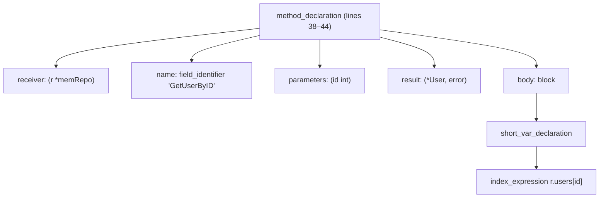

**tree-sitter** is a parser generator used by many editors (Neovim, Zed,
GitHub code navigation). Each language has a grammar; tree-sitter produces a
concrete syntax tree quickly and incrementally, and tolerates syntax errors
(you still get a tree for half-written code). It also has a small **query
language** (S-expressions in `.scm` files) to pattern-match tree shapes and
*capture* nodes by name.

### In uxor

Each language has **one query file** using shared capture names, plus a small
**hooks** file for quirks (D5). From `internal/parse/queries/go.scm`:

```scheme
(function_declaration name: (identifier) @name body: (_)? @body) @def.function
(method_declaration name: (field_identifier) @name body: (_)? @body) @def.method
(call_expression
  function: (selector_expression operand: (_) @call.qualifier field: (field_identifier) @call.name)) @call
(import_spec) @import
```

| Capture | Meaning |
|---|---|
| `@def.<kind>` + `@name` (+ `@body`) | a definition: function, method, class, interface, type, var, test |
| `@call` + `@call.name` (+ `@call.qualifier`) | a call site such as `store.NewMemRepo()` |
| `@import` | an import statement, interpreted by the language hook |
| `@extends` / `@implements` | base types |
| `@export.name` | explicitly exported names |

A **generic walker** (`internal/parse/extract.go`) then:

1. sorts definitions and assigns **containment parents** by nesting, so
   qualified names (`store.memRepo.GetUserByID`) and function→method
   promotion need no per-language code;
2. attributes every call to the **innermost enclosing symbol** with a sweep
   (O(n log n)) and deduplicates refs;
3. calls the language **hooks** for quirks: Go receivers and package names,
   Python `__all__`, TS/JS `export`, test detection, import parsing,
   builtins to ignore (`len`, `print`, `require`, …).

**What comes out** (`parse.FileResult`):

- **Symbols**: kind (`function`, `method`, `class`, `interface`, `type`,
  `var`, `module`, `test`), name, qualified name, **signature** (the
  declaration header, whitespace collapsed, comment lines dropped, ≤ 200
  chars, D20), start/end line, exported flag. Every file also gets one
  `module` symbol, so all edges can be symbol→symbol.
- **Refs**: unresolved references *by name*: calls (`name`, `qualifier`),
  imports (`module`, `member`, alias), extends/implements.

**Nested named functions** (D30) are symbols too: a React handler
`const handleSignIn = async () => …` inside an `AuthProvider` component
becomes `AuthProvider.handleSignIn`; a Go closure `keep := func(…)` inside
`ValidNames` becomes `ValidNames.keep`; a class field `handleClick = () => …`
is a method. Local non-function variables and anonymous callbacks are not.

**Never stored:** function bodies or any source text. Only names, line
numbers and signatures, which is what lets the answer be "read lines 38–44".

**Code:** `internal/parse` (`extract.go`, `lang.go` registry, `golang.go`,
`python.go`, `ecma.go`, `ident.go`, `queries/*.scm`); D5, D20.

---

## 6. Storage: SQLite, WAL, FTS5

### Theory

**SQLite** is a complete SQL database in a single file, with no server.
Three features matter here:

- **WAL (write-ahead logging)**: writes go to a side log first, so readers
  never block on a writer and the main file stays consistent.
- **Indexes**: B-trees that make lookups by name or by edge endpoint fast.
- **FTS5**: a full-text search engine inside SQLite, with an **inverted
  index** (word → list of rows containing it) and **BM25** ranking (section
  11).

uxor uses a pure-Go SQLite build (`ncruces/go-sqlite3`, translated from
SQLite's WebAssembly build to Go, so no C compiler is needed for the
database and start-up is ~10 ms, D2). Tree-sitter, in contrast, does need
cgo.

### In uxor: the schema

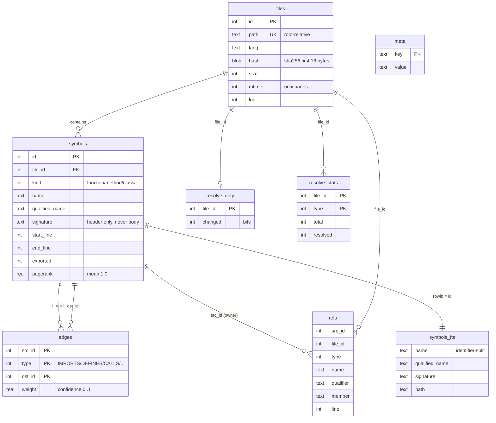

Key design points (D4, D7):

- **`edges` is a `WITHOUT ROWID` table** keyed `(src_id, type, dst_id)` plus
  an index `(dst_id, type, src_id)`: both "what does X call" and "who calls
  X" are index scans.
- **`refs` is the source of truth** for cross-file edges. Edges are *derived*
  from refs by the resolver, so when a file changes only its own refs are
  replaced and edges are recomputed.
- **`symbols_fts` is contentless** (`content=''`): FTS5 keeps only its
  inverted index, not the text. Its columns hold **identifier-split words**
  plus the **marked whole identifier** (`getUserById` →
  `0getUserById get user by id`), never source. The `0` marker keeps
  prefix searches inside words: `"handled"*` must not match
  `handleDelete` (D31, schema v3).
- Enums (`kind`, `type`) are small integers, append-only so old indexes stay
  valid. **Migrations** are an ordered list keyed by `PRAGMA user_version`.
- **Connection settings**: WAL, `synchronous=NORMAL`, `mmap_size=256MiB`,
  `cache_size=16MiB`, `busy_timeout=5000`; writers use `BEGIN IMMEDIATE`;
  readers open read-only.

**Edge types** (`parse.EdgeType`):

| Edge | From → to | Example |
|---|---|---|
| `IMPORTS` | module → module | `api/handler.go` imports `store` |
| `DEFINES` | parent → child | class → method, module → function |
| `CALLS` | caller → callee | `Render` → `GetUserByID` |
| `EXTENDS` | type → base | class → superclass, Go embedded field |
| `IMPLEMENTS` | type → interface | TS `implements` |
| `TESTS` | test → code under test | `TestGetUserByID` → `GetUserByID` |

**Code:** `internal/store/schema.sql`, `schema_v2.sql`, `store.go`,
`write.go`, `read.go`, `graph.go`; D2, D4, D7.

---

## 7. The indexing pipeline

### Theory: producer/consumer parallelism

Parsing is CPU-bound and independent per file, so it parallelises well.
Writing to SQLite is best done by **one writer** in large transactions
(thousands of small transactions are slow). The classic shape is a **worker
pool** feeding a **single consumer**.

### In uxor

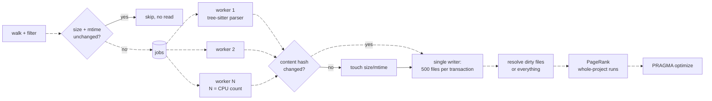

- **Cheap check first**: size + mtime against the `files` table; only
  changed-looking files are read and hashed (sha256, first 16 bytes); only a
  changed hash is re-parsed (D6).
- **Workers** (`errgroup`, `GOMAXPROCS`) each own one parser per language;
  trees are freed right after extraction.
- **One writer** applies results in transactions of 500 operations.
- **Progress**: in a terminal, `index`/`init` show a live line
  (`⠹ parsing 1,284 / 2,982 files 1.2s`) then `✓` lines; elsewhere a plain
  summary (D29).

**Code:** `internal/index/indexer.go` (`Run`, `parseAll`, `writer`),
`cmd/uxor/progress.go`; D6, D29.

---

## 8. Incremental indexing

### Theory

Re-indexing everything after each edit would be wasteful. The goal is
**work proportional to the change**: re-parse the edited file, and recompute
only the edges whose answer could have changed. The hard part is knowing
*which* edges, without missing any.

### In uxor

The key observation (D11): **the edges leaving file X depend only on X's
refs and on what other files expose** (names, kinds, exports, imports).
Resolution never reads edges. So after an edit:

1. **Stable symbol IDs**: unchanged symbols keep their IDs (matched by kind,
   name, qualified name, parent, exported), so other files' edges into them
   stay valid.
2. **Dirty marking**, in the same write transaction: the edited file, plus
   files that could resolve differently now, e.g. files calling a removed
   name, importers of a file whose exports changed, subclasses of a changed
   base, all files of a changed Go package.
3. **Scoped resolve** of only the dirty files. If they exceed **25% of all
   files** (`resolve.FullFraction`), or a marker file such as `go.mod`,
   `tsconfig.json`, `package.json` changed, a **full** resolve runs instead.

`TestScopedEqualsFull` proves the scoped result equals a full resolve after
scripted edits, and each marking rule is mutation-checked.

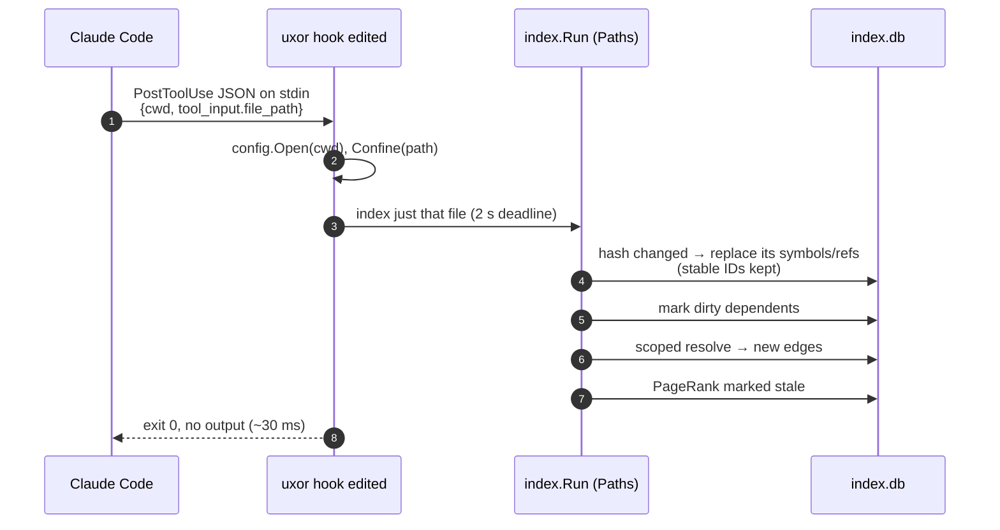

**Code:** `internal/index/indexer.go`, `internal/store/write.go`
(`replaceTracked`, marking rules), `internal/resolve/resolve.go`
(`expandDirty`); D11.

---

## 9. Resolution: building the graph

### Theory: name resolution

A call `GetUserByID(5)` names a function, but *which* one? Compilers answer
this with **scopes** (lexical nesting: block, function, module, package),
**imports** (which names a file brings in, under which alias), and **types**
(`repo.Find()` depends on `repo`'s type). Exact resolution needs a full
type checker per language. uxor does a fast, **heuristic** version and
records **how sure** it is as an edge weight.

### In uxor: resolution order and weights (D12)

Each call/extends ref goes through `resolveName`
(`internal/resolve/resolver.go`), first match wins:

| # | Rule | Example | Weight |
|---|---|---|---|
| 1 | declared parameter type | `repo store.Repository` → `Repository.Find` | 1.0 |
| 2 | `self`/`this`/`cls`/`super`/Go receiver | `self.save()` → method of the class or its bases | 1.0 |
| 3 | import binding (incl. re-exports, depth 3) | `store.NewMemRepo()` | 1.0 |
| 4 | unqualified name in lexical scope / package | `helper()` | 1.0 |
| 5 | unknown receiver `obj.m()`: methods named `m` nearby | 1 candidate / 2–3 candidates | 0.5 / 0.25 |
| 6 | repo-wide unique name (Python/JS/TS, ≥ 4 chars) | `formatTotal()` | 0.3 |

Measured precision by hand-checking samples: weight 1.0 → 20/20 correct,
0.5 → 7/10, 0.25 → ~6/10, 0.3 → 6/8. Weights below 1 are labelled
"guesses" in tool output.

**Precision guards:** names bound to **external imports** (stdlib,
third-party) are never guessed into the repo (`errors.Is` stays
unresolved); method calls never use the repo-wide rule; Go never uses rule 6.
That is why `stats` shows only ~30–60% of calls resolved: the rest point
outside the repository, by design.

**Per-language import rules** (D13):

- **Go**: import paths through every `go.mod` (longest module path wins);
  IMPORTS edges to each non-test file of the package at weight 1/n.
- **Python**: source roots = repo root, `src/`, directories with
  `pyproject.toml`/`setup.py`/`setup.cfg`, plus `resolve.python_roots`;
  relative imports; `from pkg import name` prefers submodule `pkg.name`.
- **TS/JS**: bundler-style probing (`./x` → `x.ts`, `index.ts`,
  `./x.js` → `x.ts`), nearest `tsconfig.json`/`jsconfig.json` with
  `extends`, `paths`/`baseUrl`, workspace packages by `package.json` name.

**TESTS edges** (D14): symbol-level (test → what it calls) and file-level
by convention (`x_test.go` → `x.go`, `test_x.py` → `x.py`, `x.test.ts` →
`x.ts`, weight 1.0) or by import (0.5).

A real resolved graph: part of the Go fixture's golden edges
(`internal/resolve/testdata/go.edges`). Solid arrows are certain (1.0),
dotted ones are guesses (0.25: `h.repo.GetUserByID()` has an unknown receiver
type, so both methods named `GetUserByID` are candidates).

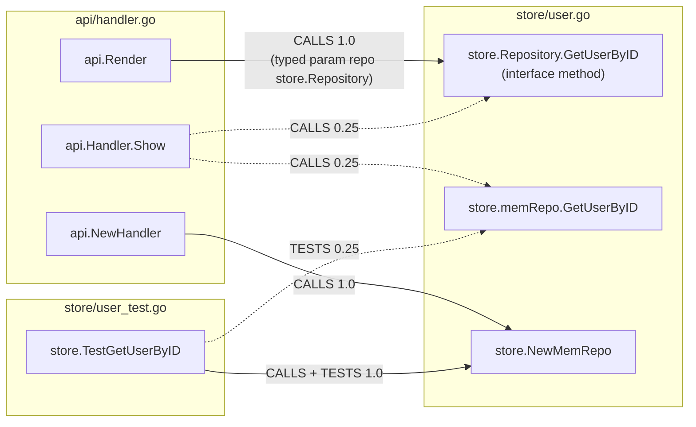

File-level edges in the same golden: `api/handler.go` IMPORTS
`store/user.go`, and `store/user_test.go` TESTS `store/user.go` (by the
`x_test.go` → `x.go` naming convention).

**Code:** `internal/resolve` (`resolver.go`, `symtab.go`, `golang.go`,
`python.go`, `ecma.go`, `params.go`, `tests.go`); D12–D14.

---

## 10. PageRank

### Theory: the random surfer

PageRank (Brin and Page, 1998) scores nodes in a graph by **how much
important stuff points at them**. Picture a surfer who follows a random
outgoing link with probability *d* (the damping factor, 0.85), or jumps to a
random node with probability 1 − *d*. A node's PageRank is the long-run
share of time the surfer spends there:

$$
PR(v) = \frac{1-d}{N} + d \sum_{u \to v} PR(u)\,\frac{w(u,v)}{\sum_{x} w(u,x)}
$$

It is computed by **power iteration**: start uniform, apply the formula
repeatedly until scores stop changing.

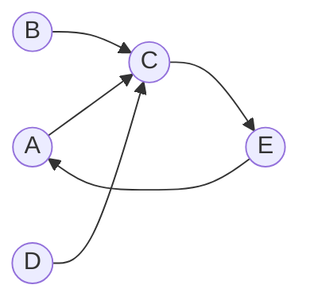

Here C is called by three nodes, so it ranks highest; E inherits importance
from C even with one caller.

### In uxor (D15)

- Graph: IMPORTS, CALLS, EXTENDS, IMPLEMENTS, **weighted by confidence**;
  DEFINES and TESTS are excluded (test volume shouldn't inflate rank).
- d = 0.85, ≤ 30 iterations or L1 change < 1e-6; dangling mass spread
  uniformly; int32 edge arrays for memory.
- Scores scaled ×N so the **mean is 1.0**, comparable across repos.
- Whole-project runs recompute it (~50 ms prometheus, ~130 ms django);
  single-file edits mark it stale.
- **How it is used** (D17): as a gentle **multiplier**,
  `× (1 + 0.1·ln(1 + pagerank))`. An earlier additive version let hubs like
  `labels.FromStrings` outrank real matches on rank alone.

**Hubs**: nodes with more than `hub_fanin` (100) incoming edges are scored
but not *expanded through* during retrieval (section 11), or every query
would reach half the repo through `log.Println`-like functions.

**Code:** `internal/resolve/pagerank.go`; D15, D17, D18.

---

## 11. Retrieval: the core algorithm

`retrieve.FindRelevant(ctx, store, config, prompt, Options{Budget, MaxFiles, Tuning})`
is shared by the CLI `query`, the MCP `find_relevant` tool and the prompt
hook.

```mermaid
flowchart LR
  P(["prompt:<br/>'get user by id'"]) s1@--> TK["1 · tokenize<br/>terms + identifiers<br/>+ test intent"]
  TK s2@--> SD["2 · seeds<br/>FTS5 MATCH + BM25<br/>+ exact-name boost"]
  SD s3@--> FU["3 · fuse sources<br/>(RRF; FTS only today)"]
  FU s4@--> EX["4 · expand graph<br/>≤ 2 hops, decay 0.5,<br/>edge weights, hubs"]
  EX s5@--> RK["5 · rank<br/>× PageRank, test factor,<br/>tested bonus"]
  RK s6@--> PK["6 · pack<br/>≤ budget tokens,<br/>≥ 25% of best"]
  PK s7@--> OUT(["path:start-end signature<br/>lines"])
  s1@{ animate: true }
  s2@{ animate: true }
  s3@{ animate: true }
  s4@{ animate: true }
  s5@{ animate: true }
  s6@{ animate: true }
  s7@{ animate: true }
```

### 11.1 Tokenize (D16)

The prompt is split with **the same splitter** that built the FTS columns, so
`getUserById`, `get_user_by_id` and "get user by id" produce the same terms
(`get`, `user`, `id`). Terms are lowercased and deduplicated; at most 24.

- **Identifiers** (`snake_case`, `camelCase`, `HTTPServer`, dotted parts,
  capitalized words) are also kept whole for the exact-name boost.
- **Stopwords**: English function words and prompt noise (`fix`, `bug`,
  `please`, `function`, `file`…), but *not* identifier words like `get`,
  `set`, `add`, `delete`. File-extension words (`go`, `py`, `ts`) are
  stopwords, since every path contains one.
- **Test words** (`test`, `spec`, …) are *intent*, not search terms: they set
  `WantsTests` (searching `test*` matched 35k of 50k django symbols).
- **Whole identifiers** (`formatUser`) are searched exactly against the
  marked token (`"0formatuser"`), never as a prefix (D31).
- **Hyphenated compounds** (`sign-in`) are also a **phrase** (`"sign in"`,
  adjacent words) and a joined word (`signin`), so "sign-in" finds
  `handleSignIn` and not `signOut` (D32).
- **Synonyms**: a deliberately small list of groups that differ between
  prompts and code (login / log in / sign in / signin / logon; logout …;
  signup …). Mentioning one member searches all (D32).

### 11.2 Seeds: full-text search and BM25 (D17)

**Theory: BM25.** For a query of terms *q₁…qₙ*, BM25 scores a document *D*:

$$
\text{score}(D) = \sum_{i} \text{IDF}(q_i)\cdot
\frac{f(q_i, D)\,(k_1+1)}{f(q_i, D) + k_1\left(1 - b + b\,\frac{|D|}{\text{avgdl}}\right)}
$$

- *f(q, D)*: how often the term occurs in *D* (more is better, with
  diminishing returns controlled by *k₁*);
- **IDF** (inverse document frequency): rare terms count more than common
  ones (`GetUserByID` beats `get`);
- the *b* term normalises for document length (a hit in a short name beats
  one in a long signature).

**In uxor:**

- Every term becomes a **quoted** FTS5 string, OR'ed together; terms of
  4+ characters also match as prefixes (`"user"*` finds `users`,
  `username`). Prompt text can never become FTS syntax (`NEAR`, `-`, column
  filters): `TestFTSInjection` feeds hostile input through a real table.
- `bm25(symbols_fts, 10, 5, 2, 3)`: **column weights** for name, qualified
  name, signature, path. A name hit counts 10×, a path hit 3× (raised from 1
  in Phase 5, D28).
- Scores are normalised so the best seed is 1.0; a symbol whose **name
  exactly equals** a query identifier gets **+0.5**, and identifiers are also
  looked up directly by name so an exact hit is never lost.
- Top `seeds` (20) symbols continue.

### 11.3 Fusion: reciprocal rank fusion

**Theory.** When several retrievers each produce a ranked list (keyword
search, embeddings, ...), **RRF** combines them without calibrating their
scores: each item gets Σ 1/(k + rankᵢ), with k = 60.

**In uxor:** seeds come through a `Source` interface; FTS is the only
source today, so its list passes through unchanged. This is the plug-in
point for a future **embeddings** source (section 18).

### 11.4 Expansion: walking the graph (D18)

**Theory: breadth-first search (BFS)** visits a node's neighbours, then their
neighbours, and so on. Bounding the depth and decaying scores per hop turns
it into a "related code" finder: code that doesn't share the prompt's words
but is directly connected to code that does.

**In uxor:** from the seeds, BFS in **both directions**, at most
`depth` (2) hops, expanding the best `max_per_hop` (50) frontier nodes, one
batched SQL query per direction per hop:

```
path score = parent path × edge-type weight × edge confidence × hop decay (0.5)
```

| Edge type | weight outgoing (frontier → neighbour) | incoming |
|---|---|---|
| CALLS | 1.0 (a callee) | 0.8 (a caller) |
| EXTENDS / IMPLEMENTS | 0.7 | 0.7 |
| DEFINES | 0.6 | 0.5 |
| TESTS | 0.5 | 0.5 |
| IMPORTS | 0.3 | 0.3 |

Each node keeps only its **best** path and remembers where it came from, so
every result can explain itself: `# called-by api.Render`,
`# tested-by TestGetUserByID`. Hubs are scored but not expanded.

### 11.5 Ranking (D17, D28)

$$
\text{score} = (\text{seed} + \text{expansion}\cdot \text{testFactor}) \times \bigl(1 + 0.1\,\ln(1+\text{pagerank})\bigr) + 0.05\,[\text{has a test}]
$$

- **testFactor**: ×1.5 for test code when the prompt asks about tests;
  otherwise ×1.0 (it was ×0.5 until Phase 5; the eval showed commits usually
  change a test with its code, D28). Applied to seeds *before* expansion
  too.
- Only the top 200 nodes are looked up in detail.

### 11.6 Packing into a budget (D19)

**Theory:** a **knapsack-style** greedy fill: take items in value order while
they fit.

**In uxor:**

- Candidates in score order, while the rendered text fits the **token
  budget** (`query_tokens` 1,000; hook 500); a line that doesn't fit is
  skipped so a shorter one can still fit; the best line is always included.
- **Relative cutoff**: candidates below **25% of the best** are dropped. The
  budget is a ceiling, not a target.
- Files are ordered by **best symbol + 0.25 × the next three**, so several
  hits lift a file but many weak ones can't beat one strong one.
- Output: `path:start-end  [kind] signature`, methods indented under their
  class, the path repeated on every line so each line can go straight to a
  Read tool. The kind word is omitted when the signature already says it
  (`func`, `def`, `class`, …).

### 11.7 Tuning

Every constant above lives in one struct, `retrieve.Tuning`
(`DefaultTuning()`), so the eval can try variants without rebuilding (D26):

| Field | Default | Meaning |
|---|---|---|
| `bm25` | `[10, 5, 2, 3]` | column weights: name, qualified name, signature, path |
| `exact_boost` | 0.5 | added for an exact name match |
| `prefix_min_len` | 4 | shortest term that also prefix-matches |
| `hop_decay` | 0.5 | multiplier per hop |
| `edges` | table above | per edge type [outgoing, incoming] |
| `pagerank_weight` | 0.1 | PageRank multiplier strength |
| `tested_bonus` | 0.05 | bonus for symbols some test covers |
| `test_penalty` / `test_boost` | 1.0 / 1.5 | test code factor without / with test intent |
| `rest_weight` / `rest_count` | 0.25 / 3 | file score from its next symbols |
| `min_rel_score` | 0.25 | relative cutoff |

**Code:** `internal/retrieve` (`retrieve.go`, `tokenize.go`, `source.go`,
`fts.go`, `expand.go`, `rank.go`, `pack.go`, `tuning.go`); D16–D19, D26,
D28.

---

## 12. MCP: the Model Context Protocol

### Theory

**MCP** is an open protocol for connecting AI applications to tools and data.
An **MCP client** (Claude Code) launches or connects to **MCP servers**; each
server advertises **tools** (name, description, JSON input schema), and the
model can decide to call them. Messages are **JSON-RPC 2.0** (`{"jsonrpc":
"2.0", "id": 1, "method": "tools/call", "params": {...}}`). The simplest
transport is **stdio**: the client starts the server as a child process and
they exchange newline-delimited JSON over stdin/stdout.

The lifecycle: `initialize` (capabilities and server *instructions*) →
`notifications/initialized` → `tools/list` → any number of `tools/call`.

### In uxor

`uxor serve` is an MCP server (official Go SDK,
`modelcontextprotocol/go-sdk`, stdio) for **one project**, fixed at start.
`.mcp.json` (written by `init`) tells Claude Code how to start it:

```json
{ "mcpServers": { "uxor": {
    "type": "stdio", "command": "uxor",
    "args": ["--root", "${CLAUDE_PROJECT_DIR:-.}", "serve"] } } }
```

| Tool | Input | Returns |
|---|---|---|
| `find_relevant` | `query`, `budget_tokens?` | the retrieval answer (section 11) |
| `get_symbol` | `name` (or `pkg.Type.Method`) | up to 10 definitions: path, lines, signature |
| `callers_of` | `symbol`, `limit?` | callers, best-resolved first, guesses marked |
| `callees_of` | `symbol`, `limit?` | what it calls |
| `impact_of` | `path` | importers, callers, subtypes, tests from other files |

Every result is **text plus structured content** (the same data as JSON). The
store opens **lazily and read-only** on the first call; every call checks
`disabled` first; an ambiguous name returns the candidates instead of a
guess; `impact_of` confines its path; tool errors are `isError` results the
model can see and correct, never protocol errors (D22).

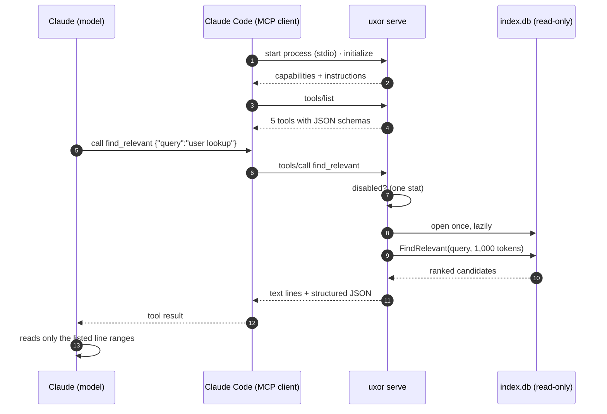

**Code:** `internal/mcpserver/server.go`, `cmd/uxor/serve.go`; D21,
D22.

---

## 13. Claude Code hooks

### Theory

**Hooks** are shell commands Claude Code runs at fixed points in its
lifecycle (when a prompt is submitted, before or after a tool runs, when a
session starts, …). Each receives a JSON payload on stdin and can add
context, allow/block an action, or do side work. They are configured in
`.claude/settings.json`.

### In uxor

```json
{ "hooks": {
  "UserPromptSubmit": [{ "hooks": [{ "type": "command", "command": "uxor hook prompt", "timeout": 5 }] }],
  "PostToolUse": [{ "matcher": "Edit|Write|MultiEdit|NotebookEdit",
                    "hooks": [{ "type": "command", "command": "uxor hook edited", "timeout": 30 }] }]
} }
```

- **`hook prompt`** (UserPromptSubmit): reads `{cwd, prompt}`, finds the
  project from `cwd`, runs retrieval at the **hook budget** (500 tokens, at
  most 5 files) and prints
  `{"hookSpecificOutput":{"hookEventName":"UserPromptSubmit","additionalContext":"Likely relevant locations …"}}`.
  Claude Code adds that text next to your prompt, before the model starts.
- **`hook edited`** (PostToolUse after Edit/Write): re-indexes the edited
  files (section 8), about 30 ms.

**The deadline.** The prompt hook runs on *every* prompt, so it must never be
felt. A `context.WithTimeout` of `hook_timeout_ms` (**250 ms**) covers opening
the store and retrieval; if it is late, it prints **nothing** rather than a
stale block (`internal/hook/hook.go`). The `timeout: 5` in settings is only
Claude Code's own backstop.

**Seeing what happened.** With `hook_log: true` in `.uxor.yaml`, each
hook run appends one JSON line to `.uxor/hook.log`: a prompt excerpt,
the files returned, tokens, ms and the outcome. It's off by default
because it stores prompt text (D33).

**Never fail.** Both hooks **always exit 0** with empty stderr: exit code 2
on UserPromptSubmit would *block your prompt*. Deliberate no-ops (disabled,
no index, slash command, empty prompt, no matches, foreign path) are
"skipped"; reasons are printed only with `UXOR_DEBUG=1`.

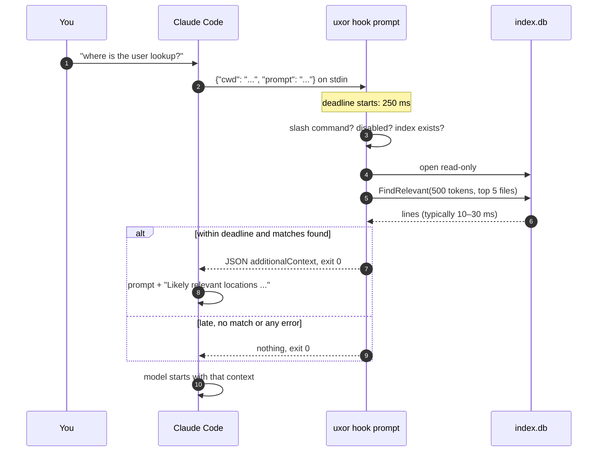

**Code:** `internal/hook/hook.go`, `cmd/uxor/hook.go`,
`internal/setup/setup.go` (`Hooks()`); D21.

---

## 14. Setup: `uxor init`

`init` wires a project into Claude Code in one step (D23):

1. **merges** a `uxor` server into `.mcp.json`;
2. **merges** both hooks into `.claude/settings.json`;
3. **appends** a marked snippet (`<!-- uxor:start … end -->`) to
   `CLAUDE.md`, telling the model to call `find_relevant` before broad
   searches and `callers_of`/`impact_of` before refactors;
4. runs the first `index` (skip with `--no-index`; preview with `--dry-run`);
5. prints the one step it can't do: approve the server in `claude`.

Merging rules: existing keys are kept, an existing `uxor` entry or hook
counts as present and is never replaced, and invalid JSON aborts before
anything is written. The `CLAUDE.md` block between the markers belongs to
uxor: re-running `init` refreshes it when the wording has changed,
never touching text outside the markers (D33). The current wording tells the
model to call `find_relevant` first for any "where is / how does X" question,
even before a targeted grep. `examples/` is generated
from the same Go values.

**Code:** `internal/setup/setup.go`, `cmd/uxor/init.go`; D23, D29.

---

## 15. The CLI

| Command | What it does |
|---|---|
| `uxor index [--full] [paths…]` | index the project (incremental) or only some paths |
| `uxor query "<text>" [--budget N] [--json] [--why]` | what the hook/MCP would answer, with reasons |
| `uxor stats [--json]` | files, symbols, edges per language; resolution rates; hubs; PageRank top |
| `uxor init [--dry-run] [--no-index]` | set up Claude Code for this project |
| `uxor serve` | the MCP server (stdio) |
| `uxor hook prompt\|edited` | the two hooks (JSON on stdin; always exit 0) |
| `uxor eval […]` | measure retrieval on this repo's history (section 16) |
| `uxor disable` / `enable` | pause/resume context injection |
| `uxor forget <glob>…` / `unforget` | keep paths out of the index |
| `uxor clean [-y]` | delete this project's index |

Global flag: `--root <dir>`. All commands resolve **one** project (section
3). Build with `make build` (cgo for tree-sitter; the Makefile handles this
Mac's x86-Go-on-ARM setup).

---

## 16. Measuring it: the eval

### Theory: information-retrieval metrics

Retrieval quality is measured with **queries** whose correct answers
(**relevant documents**) are known:

- **hit rate**: the share of queries where *any* relevant item is in the
  returned set;
- **recall@k**: the share of *all* relevant items found in the top *k*;
- **MRR** (mean reciprocal rank): the average of 1/rank of the first
  relevant item (1.0 = always first; 0.5 = typically second).

Two pitfalls from machine learning apply:

- **Leakage**: if the test data contains the answer, scores are too good.
- **Overfitting**: tuning knobs until one dataset looks great; guarded
  against by a **holdout** set never used for choosing.

### In uxor (D25–D28)

Real history is the test set: each **commit subject is a query** and the
**indexed files it changed are the answer**. To avoid leakage, the honest
mode (`--checkout-parent`) indexes each commit's **parent** in a temporary
git worktree.

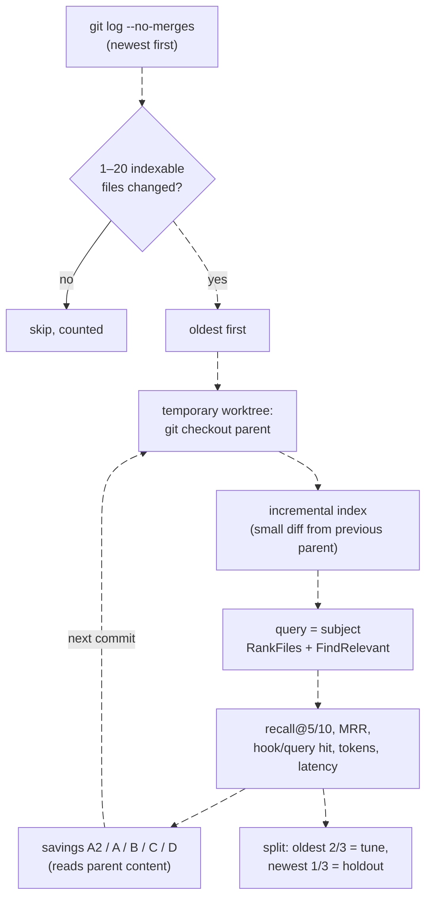

- **Variants**: repeat `--tuning file.json` to score several `Tuning`s
  against the *same* indexes (indexing dominates cost).
- **Token savings model** (chars/4, discovery + reading only):
  - **B, perfect search**: read exactly the changed files;
  - **C, uxor best**: the block + each edit's enclosing symbol ±10 lines;
  - **D, uxor realistic**: the real answer; a miss costs the block
    plus a simulated agent;
  - **A2, simulated agent**: grep + read matching ranges (still heavy, so
    B is the conservative baseline).

**Results** (100 commits each, honest mode, after tuning; full tables in
[`BENCHMARKS.md`](BENCHMARKS.md)):

| | django (Python) | prometheus (Go) | vite (TypeScript) |
|---|---|---|---|
| changed file in the hook block | 71% | 80% | 55% |
| MRR (at HEAD, leaking) | 0.61 (0.70) | 0.68 (0.71) | 0.44 (0.51) |
| token saving vs perfect search | **42%** | **51%** | **21%** |
| on hits, median tokens: uxor vs perfect search | 5.3k vs 18.5k | 7.2k vs 32.1k | 6.9k vs 11.6k |

**Code:** `internal/eval` (`git.go`, `eval.go`, `metrics.go`, `savings.go`),
`cmd/uxor/eval.go`; D25–D28.

---

## 17. Performance and limits

| Measure | Value | Target |
|---|---|---|
| full index, django (2,982 files) | ~3–4 s | none |
| body-only edit, re-index | 30–110 ms | none |
| query memory (peak RSS) | 19–23 MB | < 100 MB |
| query latency in-process | 5–15 ms | < 200 ms |
| prompt hook end to end (warm p95) | 45–79 ms | < 300 ms (deadline 250) |
| index-time memory | 130–160 MB | none (known issue) |

**Known limits** (`docs/TODO.md` §4):

- not yet measured on 1M+ LOC repositories;
- class fields (`self.repo: Repo`) and Go struct field types aren't used for
  resolution, so `self.repo.find()` is a guess;
- no REFERENCES edges for type usages;
- TypeScript retrieval is the weakest (vite 55% hook hits);
- adding an import to a widely imported module re-resolves all its
  importers (~0.4 s);
- the hook adds ~360–430 tokens to every prompt, useful about 7 times in 10.

---

## 18. Extending uxor

- **A new language** (D5): add `internal/parse/queries/<lang>.scm` using the
  shared captures, a hooks file (imports, exports, tests, builtins), one line
  in the registry (`internal/parse/lang.go`), and resolver import rules in
  `internal/resolve`. Run `make golden` and review.
- **Embeddings** (planned): implement `retrieve.Source`
  (`Seeds(ctx, q, n)`) backed by a local model (e.g. Ollama) and
  `sqlite-vec`; RRF already fuses several sources.
- **LSP edges** (planned): precise edges from gopls/pyright/tsserver as
  another edge source with weight 1.0.
- **Framework plugins** (planned): routes and models as edges (Express
  routes, Django URLs, AWS CDK).
- **New tuning knobs**: add a field to `retrieve.Tuning` with a JSON tag and
  a default; the eval can sweep it immediately.

---

## 19. Glossary

| Term | Meaning |
|---|---|
| **Agent** | an LLM in a loop with tools |
| **AST** | abstract syntax tree: code as a tree of constructs |
| **BFS** | breadth-first search: visit neighbours level by level |
| **BM25** | the classic keyword-ranking formula (term frequency, IDF, length normalisation) |
| **cgo** | Go calling C code; needed for tree-sitter |
| **Context window** | everything the model sees in a session, in tokens |
| **Contentless FTS** | an FTS5 index that stores the inverted index but not the text |
| **Edge weight** | uxor's confidence that a resolved edge is right (1.0 certain) |
| **FTS5** | SQLite's full-text search engine |
| **Holdout** | data kept aside to check tuning didn't overfit |
| **Hook** | a command Claude Code runs at a lifecycle event |
| **Hub** | a node with very many incoming edges; not expanded through |
| **IDF** | inverse document frequency: rarer terms weigh more |
| **Inverted index** | word → rows containing it |
| **Leakage** | the test data contains the answer |
| **MCP** | Model Context Protocol: a standard for tools for AI apps |
| **MRR** | mean reciprocal rank of the first correct result |
| **PageRank** | node importance from the importance of nodes pointing at it |
| **Recall@k** | share of relevant items in the top *k* |
| **Ref** | an unresolved reference by name (a call, an import) |
| **Resolution** | turning a ref into an edge to a specific symbol |
| **RRF** | reciprocal rank fusion: combine ranked lists by Σ 1/(k + rank) |
| **Symbol** | a definition: function, method, class, type, variable, module, test |
| **Token** | the unit LLMs read; ~4 characters of code |
| **tree-sitter** | a fast, error-tolerant parser library with a query language |
| **WAL** | write-ahead log: SQLite mode where readers don't block on writers |
| **Worktree** | an extra checkout of a git repo in another directory |

---

## 20. Further reading

| File | What's in it |
|---|---|
| [`DECISIONS.md`](DECISIONS.md) | every design decision D1–D33, with reasons and measurements |
| [`BENCHMARKS.md`](BENCHMARKS.md) | full eval results, savings tables, worked examples, caveats |
| [`TESTING.md`](TESTING.md) | how to check every feature by hand |
| [`TODO.md`](TODO.md) | roadmap, status, code map, known issues |
| `internal/*/testdata` | golden files: what the parser, resolver and retrieval produce on fixtures |

Decision index by topic:

| Topic | Decisions |
|---|---|
| storage and schema | D2, D4, D7 |
| projects and isolation | D8, D9 |
| parsing | D5, D20, D30 |
| indexing | D6, D11, D29 |
| resolution and graph | D12, D13, D14, D15 |
| retrieval | D16, D17, D18, D19, D26, D28, D31, D32 |
| MCP, hooks, init | D21, D22, D23, D33 |
| eval and savings | D25, D26, D27, D28 |
